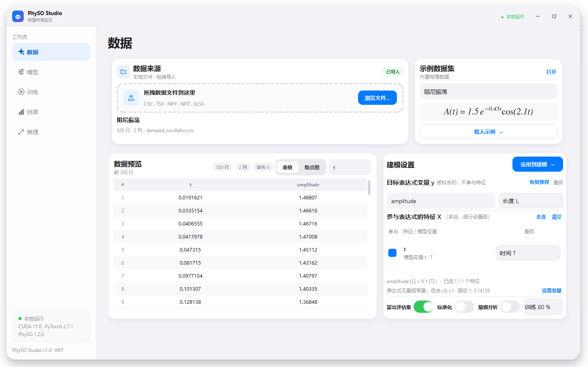
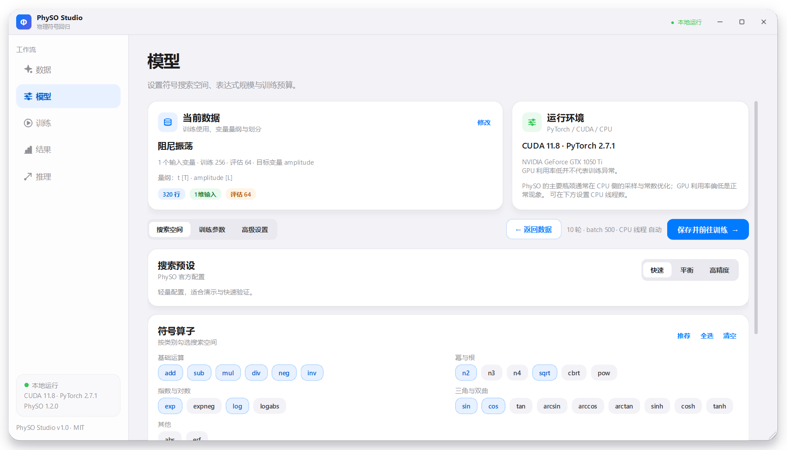
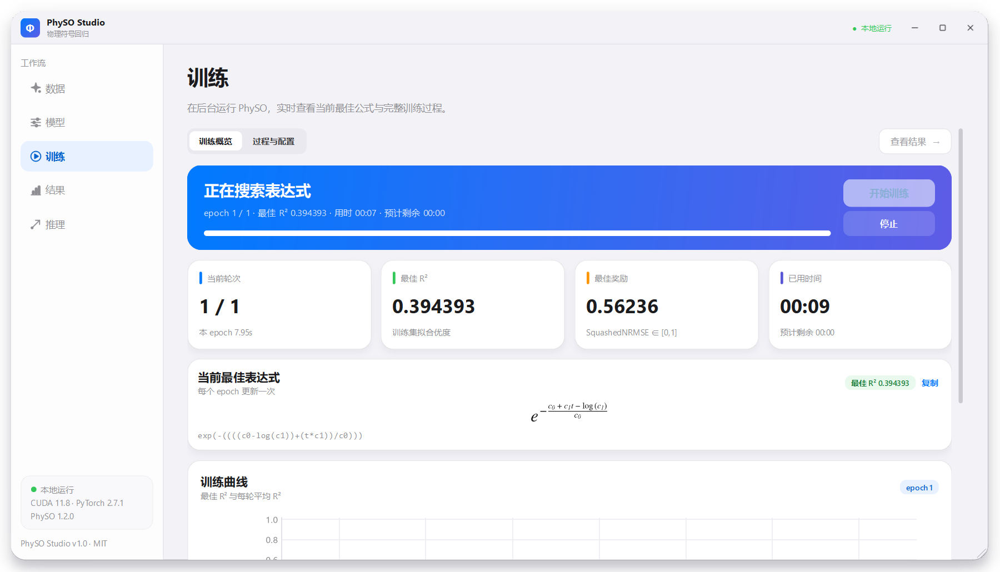
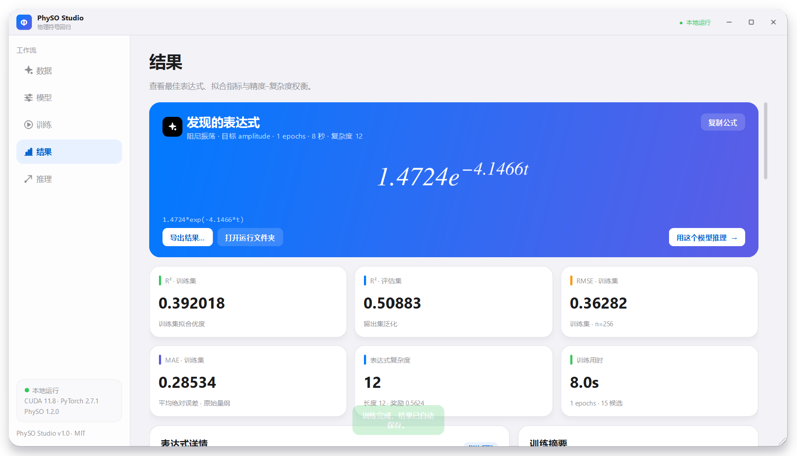
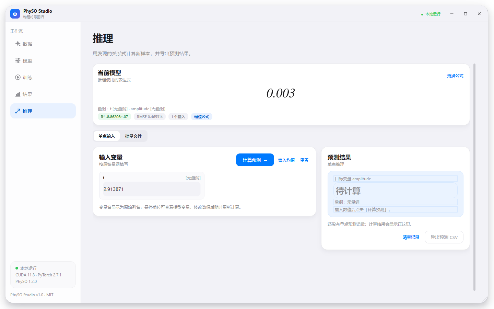

# PhySO Studio

PhySO Studio 是一个基于 **PySide6** 的本地桌面应用，为 [PhySO（Physical Symbolic Optimization）](https://github.com/WassimTenachi/PhySO) 提供 iOS 风格的可视化工作流：

> 导入数据 → 选择变量 → 设置算子与搜索预算 → 训练 → 查看解析表达式与 Pareto 前沿 → 用表达式推理 → 保存 / 载入结果。

整个应用完全在本机运行，不需要浏览器或服务器。

---

## 功能

- **数据导入**：CSV / TSV / TXT / NPY / NPZ / XLSX，支持拖拽；自动识别分隔符、表头与数值列。
- **变量与量纲**：明确区分「目标表达式变量 y（被拟合列）」与「参与表达式的特征 X」；特征可多选，且每行独立设置量纲（长度/质量/时间/温度/电流/物质的量/光强，以及速度、力、能量、压强等组合），也支持 7 维自定义指数。目标 y 也有独立量纲，示例数据会自动预填推荐值，并可一键恢复推荐。
- **数据预览**：表格带行号、居中对齐，支持「表格 / 散点图」切换，避免在长页面上重复堆叠图表。
- **数据划分**：可留出评估集（50%–90% 训练比例），也可用全部数据训练；可选标准化并在结果中换算回原始量纲；可选择性启用量纲分析。
- **无量纲常量**：表达式可使用自由常数 `c0, c1…` 与固定常数（默认 `1, π`，可快速追加 `π / e / 2`）；数据页实时显示当前启用的常量，并可跳转到模型页修改。
- **参数配置**：PhySO `config0 / config2 / config1` 三档预设，27 种分组算子，表达式最大长度、**1–100,000 轮迭代**、batch、学习率、停止阈值、自由/固定常数、随机种子、CPU 线程、CPU/GPU、并行开关等。
- **后台训练**：QThread 中运行 PhySO；**每个 epoch 实时渲染截至当前轮次的最优公式**。训练页分为「训练概览 / 过程与配置」两个子视图，分别展示实时曲线、逐轮指标、运行日志和完整配置，避免页面无限变长。支持停止并保留当前最优结果。
- **数学公式渲染**：所有公式通过 SymPy → LaTeX → matplotlib mathtext 渲染为真正的数学排版，支持分数、指数、根式、对数、三角函数、绝对值以及多层嵌套；`n2(x)` 等 PhySO 算子会转写为 `x²`、`log|x|` 等数学记号。
- **结果分析**：渲染后的最佳表达式、6 项指标（训练/评估 R²、RMSE、MAE、复杂度、用时）、训练摘要、变量量纲、自由常数值、Pareto 前沿表格/图、候选公式预览、训练/评估拟合图与残差图、逐轮历史表。
- **推理**：紧凑的字段卡片输入（自动填入中位数，可一键均值/重置），预测值以高亮结果卡展示；支持批量文件/当前数据集预测，空历史有轻量提示，结果可导出 CSV。
- **结果持久化**：每次训练自动写入 `runs/<时间戳-数据集>/`，包含 `result.json`、表达式、配置、预测 CSV、PNG 图表、PhySO 日志；支持重新载入结果继续推理。
- **示例数据**：内置 9 个带公式与量纲说明的物理/数学数据集。
- **界面**：无边框圆角窗口（iOS 风格弹窗观感）、自定义标题栏、iOS 浅色卡片、开关、分段控件、页面淡入动画；支持 `Ctrl+1…5` 切换页面。窗口启动时按屏幕可用区域自动调整尺寸，避免超出屏幕；数据页、模型页和训练页均采用紧凑布局/子视图切换，常用操作在首屏可见；不设单独简介页。

---

## 界面预览

| 数据 | 模型 |
| --- | --- |
|  |  |
| **训练** | **结果** |
|  |  |
| **推理** | |
|  | |

---

## 快速开始

### 1. 环境要求

- Windows 10/11（已在 Windows + NVIDIA GTX 4 GB 上验证）
- Miniconda / Anaconda
- Python 3.11（PhySO 与 PyTorch 的稳定组合）
- 可选 NVIDIA GPU（CUDA 11.8 或更高驱动）；PhySO 常受 CPU 侧采样/常数优化限制，GUI 默认使用 CPU，可切换到 CUDA

### 2. 创建 conda 环境

```bat
conda create -n physo-ui python=3.11 -y -c conda-forge
conda activate physo-ui
set PYTHONNOUSERSITE=1
```

> 如果本机 conda 配置了不可用的镜像（例如清华源返回 403），使用
> `conda create -n physo-ui python=3.11 -y --override-channels -c https://conda.anaconda.org/conda-forge`。

### 3. 安装 PyTorch

先安装适合本机 CUDA 的 wheel，避免 pip 从 PyPI 拉到 CPU 版本：

```bat
:: CUDA 11.8（本项目验证环境；也匹配 522.06 驱动）
pip install torch==2.7.1+cu118 --index-url https://download.pytorch.org/whl/cu118

:: 其他 CUDA 版本请参考 https://pytorch.org/get-started/locally/
:: 纯 CPU：
:: pip install torch==2.7.1
```

### 4. 安装其余依赖（含 PhySO）

```bat
pip install -r requirements.txt
```

`requirements.txt` 会从 GitHub 安装 PhySO 1.2.0（PyPI 上仍是旧的 1.1.x）。

### 5. 启动

双击 **`run.bat`**，或：

```bat
python -m physo_ui
```

`run.bat` 会设置 `PYTHONNOUSERSITE=1`、定位 `physo-ui` 环境、检查依赖，然后启动 GUI。

---

## 使用流程

### 1. 数据

- 点击「浏览文件…」或把文件拖入虚线区域；也可以从右侧示例卡片载入内置数据。
- 在「建模设置」中确认目标表达式变量 y（被拟合列，不参与输入特征），再勾选参与表达式的特征 X；顶部公式预览会实时显示 `y [量纲] = f(特征 [量纲], …)`。
- **逐个选择量纲**：每个特征和 y 都有一个量纲下拉框，内置无量纲、长度、质量、时间、温度、电流、物质的量、光强、速度、加速度、力、能量、压强、电荷等预设；选择「自定义量纲…」可编辑 7 维指数（L, M, T, I, Θ, N, J）。载入示例后可用「恢复推荐」重置变量与量纲。
- 数据预览可在「表格」和「散点图」之间切换；表格带行号与居中数值。
- 数据页会显示当前表达式无量纲常量（自由 `c0…` 与固定 `1, π…`），点击「设置常量」直接跳到模型页的常量设置。
- 按需开启「留出评估集」「标准化数据」「启用量纲分析」，点击右上角 **应用到建模 →**。

> 量纲分析默认关闭：自由常数在 PhySO 中按无量纲处理，对含 `exp(t)`、`1/T` 之类参数的数据，盲目开启可能过滤掉正确形式。确认量纲与常数假设后再开启。
> 只有数值列可以参与建模；缺失值、`inf` 会在训练前自动剔除。建议有效样本不少于 30 行。

### 2. 模型

- 模型页使用 **搜索空间 / 训练参数 / 高级设置** 三个子视图，顶部始终保留「返回数据」和「保存并前往训练」。
- **搜索预设**：快速（config0）/ 平衡（config2）/ 高精度（config1）。
- **符号算子**：默认 12 个推荐算子，可按需增删；至少保留一个。
- **训练参数**：epoch（1–100,000，可直接输入上万轮，或使用 100 / 1k / 10k 快捷键）、batch size、学习率、提前停止奖励、自由常数个数、固定常数候选、随机种子、设备与 CPU 线程数。
- **无量纲常量**：自由常数 `c0…` 与固定常数均为无量纲 token；固定常数默认 `1, 3.14159`，可用 `π / e / 2` 按钮快速追加。
- **CPU 优先**：PhySO 的主要耗时通常来自 CPU 侧的 RNN 采样与常数优化，GPU 只加速批量张量运算。默认计算设备为 **CPU**；可选「自动」或 CUDA。若 GPU 利用率长期偏低，可改回 CPU 并调整 CPU 线程数。
- **高级设置**：risk factor、熵正则、自由常数优化步数、最大评估数、并行奖励计算（Windows 建议关闭）。
  降低「自由常数优化步数」通常能明显缩短每个 epoch 的耗时。

PhySO 推荐把数据缩放到约 1 的量级。若原始数据跨度很大（如 1e-9 ~ 1e6），请开启「标准化数据」；
结果页会自动把表达式换算回原始变量和原始 y 的量纲。

### 3. 训练

- 训练页顶部可在 **训练概览** 与 **过程与配置** 之间切换；右上角「查看结果」在训练结束后可用。
- 点击 **开始训练**，概览页实时显示当前 epoch、最佳 R²、最佳奖励、Loss、耗时、ETA 和训练曲线。
- **当前最佳公式**会随每个 epoch 更新，并以 LaTeX 数学公式渲染（支持分数、指数、根式、对数、三角函数等）。
- 「过程与配置」中包含运行状态、逐轮指标表、运行日志和完整训练配置；逐轮表记录 R²、奖励、Loss、复杂度、长度与耗时。
- **停止**：当前 epoch 结束后退出，并保留已找到的最优表达式。
- 训练完成后自动保存到 `runs/`，点击 **查看结果 →** 进入结果页。

### 4. 结果

- 顶部以大幅数学公式展示最优表达式；下方同时给出单行表达式、LaTeX、模型空间表达式与自由常数值。
- 6 项指标卡展示训练/评估 R²、RMSE、MAE、复杂度与用时；右侧训练摘要列出数据、量纲、配置、设备、轮数和运行目录。
- **Pareto 前沿**表格中点击任意一行，即可切换到该表达式；表格下方会即时渲染所选公式，推理页同步更新。
- 「拟合诊断」可切换训练集 / 评估集，查看预测–真实散点、残差与指标。
- Pareto 图、训练历史图与逐轮历史表一应俱全。
- **导出结果…** 把完整结果复制到指定文件夹；**打开运行文件夹** 查看自动保存的 PNG/CSV/日志。
- **用这个模型推理 →** 跳转到推理页。

### 5. 推理

- 当前模型公式会以数学排版显示，并在输入框与输出处标注变量量纲。
- **单点输入**：为每个变量填值（默认中位数，可一键填入均值），点击「计算预测」；历史记录可导出 CSV。
- **批量文件**：导入包含相同列的 CSV/NPY/NPZ/XLSX，批量预测并导出；若文件含目标列，会同时计算 R²/RMSE 与残差。
- **载入结果…**：无需重新训练，直接选择之前保存的 `result.json` 即可推理。

---

## 内置示例数据集

| 文件 | 变量 | 公式 |
| --- | --- | --- |
| `linear.csv` | x → y | `y = 2.5x − 1.2` |
| `damped_oscillator.csv` | t → amplitude | `A = 1.5 e^(−0.45t) cos(2.1t)` |
| `ideal_gas.csv` | V, T, n → P | `P = nRT / V` |
| `projectile_range.csv` | v0, theta → R | `R = v0² sin(2θ) / g` |
| `pendulum_period.csv` | L, g → T | `T = 2π√(L/g)` |
| `radioactive_decay.csv` | t, N0, lambda → N | `N = N0 e^(−λt)` |
| `spring_energy.csv` | k, x → E | `E = ½kx²` |
| `coulomb_force.csv` | q1, q2, r → F | `F = 8.99 q1q2 / r²` |
| `two_feature.csv` | x0, x1 → y | `y = 0.8x0x1 + 1.4x0 − 0.7x1 + 0.3` |

数据由 `scripts/make_datasets.py` 生成（固定随机种子 + 0.2%–0.4% 噪声），`datasets/index.json` 同时保存推荐量纲，载入示例时会自动填入。详见 `datasets/README.md`。

---

## 输出结构

每次训练自动创建：

```
runs/20261025-213500-damped_oscillator/
├── result.json          # 完整结果，可在 GUI 中重新载入
├── expression.txt       # pretty / 单行 / LaTeX
├── config.json          # 本次参数
├── predictions.csv      # 真实值、预测值、残差、split
├── dataset_used.csv     # 实际建模数据
├── fit_train.png / residuals_train.png
├── fit_eval.png / residuals_eval.png   # 有评估集时
├── history.png / pareto.png
├── SR.log               # PhySO 逐 epoch 候选日志
└── train.log            # GUI 日志
```

---

## 命令行选项

```bat
python -m physo_ui --help

python -m physo_ui --demo damped_oscillator.csv --prepare --page model
python -m physo_ui --load-result runs\...\result.json --page predict
python -m physo_ui --smoke                    :: 依次打开所有页面后退出（自检）
python -m physo_ui --screenshot ui.png        :: 保存窗口截图
python -m physo_ui --screenshot-all docs/screenshots  :: 每页保存一张截图
```

## 测试

```bat
python -m unittest discover -s tests -v
```

测试覆盖：变量名清洗、数据拆分与标准化、量纲元数据、自定义算子求值、9 个内置数据集的完整性、结果保存/载入、单点与批量推理。

---

## 常见问题

**Q：启动时报 `ModuleNotFoundError: PySide6 / physo / torch`？**
A：确认 `run.bat` 使用的环境是 `physo-ui`，并执行 `pip install -r requirements.txt`。
本机若存在用户级 site-packages，`run.bat` 已设置 `PYTHONNOUSERSITE=1` 避免包冲突。

**Q：训练很慢或显存不足（OOM）？**
A：降低 batch size（例如 200–500）、表达式最大长度或 epoch；设备默认使用 CPU，可尝试调整 CPU 线程数。若选择 CUDA，GTX 4 GB 级显卡建议从 batch 500–1000 开始。

**Q：R² 一直上不去？**
A：检查是否漏选关键变量；尝试增加 epoch / batch / 最大长度；加入更多算子（`n3`, `tanh`, `sqrt` 等）；
对跨度大的数据开启标准化；PhySO 的自由常数从 1 附近开始搜索，标准化通常有帮助。

**Q：公式渲染支持分数、根式、指数、对数、三角函数吗？需要安装 LaTeX 吗？**
A：支持。GUI 使用 SymPy 生成 LaTeX，再由 matplotlib mathtext 渲染，不依赖 TeX Live。
分数、嵌套指数、根式、对数、三角/反三角、双曲函数、绝对值等都会显示为数学排版；
PhySO 的 `n2`、`cbrt`、`logabs` 等算子会先转写为 `x²`、`\sqrt[3]{x}`、`log|x|` 再渲染。

**Q：表达式看起来和公式不一样？**
A：符号回归可能给出数学等价或近似形式（例如参数合并、三角恒等式）。
开启标准化时，训练在标准化空间进行，结果页展示的是换算回原始量纲的表达式。

**Q：Windows 上可以开并行吗？**
A：可以，但 PhySO 的多进程在 Windows 下容易受脚本入口/进程启动方式影响，GUI 默认使用顺序模式，稳定且通常够快。PhySO 的瓶颈通常在 CPU 侧采样/常数优化，而不是 GPU 算力。

**Q：结果能离线复现吗？**
A：固定随机种子、相同数据与参数可以在近似范围内复现；PyTorch/CUDA 的非确定性仍可能带来细微差异。

---

## 项目结构

```
physo-ui/
├── app.py                  # 入口（python app.py）
├── run.bat                 # Windows 启动脚本
├── requirements.txt
├── README.md
├── datasets/               # 9 个示例 CSV + index.json
├── runs/                   # 训练输出（自动生成）
├── scripts/
│   └── make_datasets.py    # 重新生成示例数据
└── physo_ui/
    ├── main.py             # 无边框圆角窗口、标题栏、侧边栏、导航
    ├── theme.py            # iOS 配色与 QSS
    ├── widgets.py          # Card / Toggle / SegmentedControl / GradientCard…
    ├── icons.py            # QPainter 矢量图标
    ├── mathrender.py       # LaTeX/mathtext 公式渲染（分数/根式/对数/三角…）
    ├── units.py            # 7 维量纲、预设单位、自定义量纲对话框
    ├── state.py            # 全局状态
    ├── data.py             # 数据加载、变量名清洗、量纲、表达式求值、指标
    ├── engine.py           # PhySO 训练线程、结果构建与持久化
    ├── plotting.py         # 嵌入式 Matplotlib 图表
    └── pages/
        ├── data_page.py
        ├── model_page.py
        ├── train_page.py
        ├── result_page.py
        └── predict_page.py
```

---

## 致谢与许可

- [PhySO](https://github.com/WassimTenachi/PhySO) — MIT License，符号回归搜索引擎。
- PySide6（Qt for Python）、NumPy、Pandas、SymPy、Matplotlib、scikit-learn。
- 本项目代码采用 MIT License；示例数据为按公开物理公式生成的合成数据。
